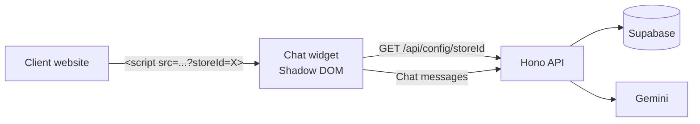

# AI Chatbot Platform — Embeddable Multi-Tenant Chat Assistant

An AI chat assistant that any website can add with **one `<script>` tag**. Each store gets its own branding, served by a shared backend.

**▶ Live demo:** https://ai-assistant-5uw.pages.dev

---

## Repositories

| Part | Repository | Stack | Hosting |
|------|-----------|-------|---------|
| **Frontend widget** | [chatbot-widget](https://github.com/Hsan003/chatbot-widget) | React, TypeScript, Vite (IIFE build), Shadow DOM | Cloudflare Pages |
| **Backend API** | [AI-Assistant-Backend](https://github.com/Hsan003/AI-Assistant-Backend) | Node.js, Hono, Supabase, Gemini | Railway |

---

## How it works



1. A site embeds the widget with its `storeId`.
2. The widget reads its own script URL, fetches that store's config (name, logo, colors, font, welcome message, position), and mounts inside a **Shadow DOM**, so the host page's CSS can't break it and the widget's CSS can't leak out.
3. Messages go to the backend, which generates replies with Gemini.

---

## Embed it

```html
<script src="https://ai-assistant-5uw.pages.dev/chat-assistant.iife.js?storeId=YOUR_STORE_ID" async></script>
```

That's all the host site needs: no framework, no build step.

---

## Key features

- **One-line embed**: a single self-contained IIFE bundle.
- **Multi-tenant**: one backend serves many stores, each with its own config.
- **Style isolation**: Shadow DOM keeps the widget's styles separate from the host page's.
- **Configurable branding**: appearance comes from the backend, not hard-coded.
- **Resilient client**: request timeouts, an error boundary, and schema-validated config.

---

## Getting started

Setup and environment variables are in each repository's README:

- [chatbot-widget](https://github.com/Hsan003/chatbot-widget#readme)
- [AI-Assistant-Backend](https://github.com/Hsan003/AI-Assistant-Backend#readme)

---

## License

MIT — see [LICENSE](LICENSE).

---

## Author

**Hsan Ellouze**: [hsanellouze.site](https://hsanellouze.site) · [LinkedIn](https://linkedin.com/in/hsanellouze) · [GitHub](https://github.com/Hsan003)
